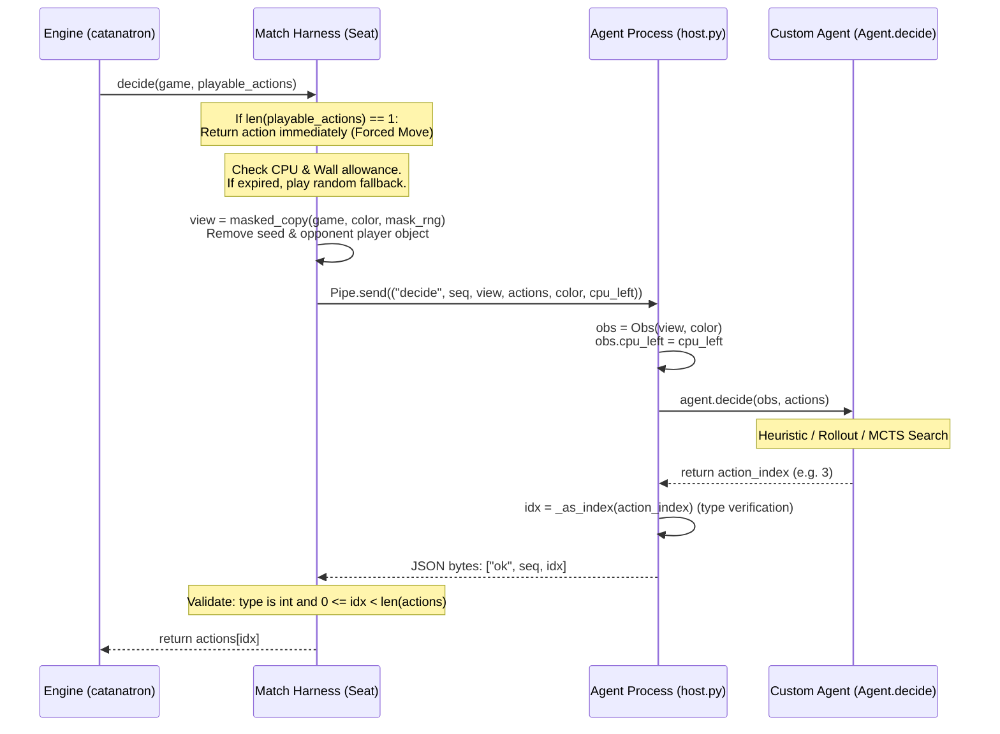

# Competition Interface & Execution Contract

## 1. Specification Overview

This document defines the strict communication and behavioral protocol between the competition match harness (`catan_kit.match`, `catan_kit.host`) and a submitted agent (`agent.py:Agent`). Adherence to this contract is mandatory; violations result in random fallback moves, loss of clock, or submission disqualification.

---

## 2. Agent Class Interface

Every submission must reside in a single directory containing `agent.py`. The harness loads `Agent` dynamically:

```python
from catan_kit.obs import Obs
from catanatron.models.enums import Action
from typing import List

class Agent:
    def __init__(self):
        """Called ONCE when the agent process starts.
        
        Timeout: 60.0 seconds (INIT_TIMEOUT_S).
        Clock: NOT charged against any game CPU clock.
        Permitted operations:
          - Load pre-computed weights, policy tables, or neural models.
          - Pre-warm torch JIT or numpy caches.
          - Initialize board distance matrices and graph topologies.
        """
        pass

    def decide(self, obs: Obs, playable_actions: List[Action]) -> int:
        """Called for every interactive decision (where len(playable_actions) > 1).
        
        Args:
            obs: Read-only observation snapshot from the agent's seat.
            playable_actions: List of valid, legal Action namedtuples.
            
        Returns:
            int: The zero-based integer index of the selected action in playable_actions.
                 Must satisfy: 0 <= return_value < len(playable_actions).
                 
        Timeout:
            Per-decision wall timeout: 3.0 seconds (CALL_TIMEOUT_S).
            Per-game CPU allowance: allowance(k) = min(0.300 + 0.0125 * (k + 1), 1.5) s.
        """
        return 0
```

---

## 3. Input Contract: What the Agent Receives

### 3.1 The `Obs` Object (`catan_kit/obs.py`)
At every call to `decide`, the agent receives `obs`, an instance of `catan_kit.obs.Obs`:

| Attribute | Type | Description | Visibility Status |
|---|---|---|---|
| `obs.me` | `catanatron.models.player.Color` | Agent's color (`Color.RED` or `Color.BLUE`). | Symmetrical / Public |
| `obs.cpu_left` | `float` or `None` | Seconds of CPU allowance remaining in this game. | Symmetrical / Public |
| `obs.turn` | `int` | Current game turn number (starts at 0). | Symmetrical / Public |
| `obs.board` | `catanatron.models.board.Board` | Board state: buildings, roads, robber, tiles, ports. | Symmetrical / Public |
| `obs.bank` | `Dict[str, int]` | Remaining resource cards in the bank (`WOOD`, `BRICK`, etc.). | Symmetrical / Public |
| `obs.my_resources` | `Dict[str, int]` | Agent's exact hand of resource cards. | Private to Agent |
| `obs.my_devs` | `Dict[str, int]` | Agent's unplayed development cards by type. | Private to Agent |
| `obs.my_public_vps`| `int` | Agent's visible victory points. | Symmetrical / Public |
| `obs.my_actual_vps`| `int` | Agent's actual victory points (includes unplayed VP cards). | Private to Agent |
| `obs.opp_resources`| `Dict[str, int]` | Opponent's exact hand of resource cards. | Symmetrical (Derived) |
| `obs.opp_dev_count`| `int` | Total count of unplayed development cards held by opponent. | Symmetrical / Public |
| `obs.opp_public_vps`| `int` | Opponent's visible victory points. | Symmetrical / Public |
| `obs.played_devs` | `Dict[str, Dict[str, int]]` | Played dev cards (`played_devs["me"]`, `played_devs["opp"]`). | Symmetrical / Public |

### 3.2 Public vs. Hidden Information
- **Opponent Hand Transparency**: In 2-player Catan without player-to-player trading, resource hands are mathematically public:
  $$\text{opp\_hand}[R] = 19 - \text{bank}[R] - \text{my\_hand}[R]$$
  The SDK computes `obs.opp_resources` directly.
- **Opponent Hidden State**:
  - The opponent's specific unplayed development cards are **hidden**.
  - The opponent's actual victory points (`ACTUAL_VICTORY_POINTS`) are **hidden** because hidden VP cards are unknown.
  - The remaining deck ordering of the development cards is **hidden**.
- **World Sampling**:
  - The agent can generate a plausible complete game state by calling `obs.sample_world(rng)`.
  - In the sampled world, the combined pool of unknown cards (opponent unplayed cards + remaining deck) is sorted and randomly redistributed according to known multiset counts.
  - The sampled `Game` is a deep copy and can be modified or stepped through without altering the actual game.

---

## 4. Legal Action Representation & Types

Actions are immutable `namedtuple` instances:
```python
Action(color: Color, action_type: ActionType, value: Any)
```

The engine emits only valid actions in `playable_actions`. The table below specifies the exact structure of `value` for each `ActionType`:

| `ActionType` | `value` Schema | Real Example |
|---|---|---|
| `ROLL` | `None` | `Action(Color.RED, ActionType.ROLL, None)` |
| `END_TURN` | `None` | `Action(Color.RED, ActionType.END_TURN, None)` |
| `BUILD_ROAD` | `Tuple[int, int]` (node IDs, $u < v$) | `Action(Color.RED, ActionType.BUILD_ROAD, (15, 16))` |
| `BUILD_SETTLEMENT` | `int` (node ID, 0..53) | `Action(Color.RED, ActionType.BUILD_SETTLEMENT, 15)` |
| `BUILD_CITY` | `int` (node ID, 0..53) | `Action(Color.RED, ActionType.BUILD_CITY, 15)` |
| `BUY_DEVELOPMENT_CARD` | `None` | `Action(Color.RED, ActionType.BUY_DEVELOPMENT_CARD, None)` |
| `PLAY_KNIGHT_CARD` | `None` | `Action(Color.RED, ActionType.PLAY_KNIGHT_CARD, None)` |
| `PLAY_ROAD_BUILDING` | `None` | `Action(Color.RED, ActionType.PLAY_ROAD_BUILDING, None)` |
| `PLAY_YEAR_OF_PLENTY` | `Tuple[str, str]` (resources) | `Action(Color.RED, ActionType.PLAY_YEAR_OF_PLENTY, ('WHEAT', 'ORE'))` |
| `PLAY_MONOPOLY` | `str` (resource name) | `Action(Color.RED, ActionType.PLAY_MONOPOLY, 'ORE')` |
| `MOVE_ROBBER` | `Tuple[Coordinate, Color \| None]` | `Action(Color.RED, ActionType.MOVE_ROBBER, ((1, -1, 0), Color.BLUE))` |
| `DISCARD_RESOURCE` | `str` (resource name) | `Action(Color.RED, ActionType.DISCARD_RESOURCE, 'SHEEP')` |
| `MARITIME_TRADE` | 5-tuple: `(give, give, give/None, give/None, get)` | `Action(Color.RED, ActionType.MARITIME_TRADE, ('WOOD', 'WOOD', None, None, 'BRICK'))` |

*Note: Domestic trading actions (`OFFER_TRADE`, `ACCEPT_TRADE`, `REJECT_TRADE`, `CONFIRM_TRADE`, `CANCEL_TRADE`) are never generated in 2-player mode.*

---

## 5. End-to-End Decision Trace

Here is the exact lifecycle of one decision from the engine to the agent and back:



### Protocol Validation Rules
1. In `catan_kit/host.py`:
   ```python
   def _as_index(x):
       if isinstance(x, bool):
           raise TypeError("bool is not an action index")
       return int(operator.index(x))
   ```
   Boolean `True`/`False` is strictly rejected. Floats and strings raise `TypeError`. Integers and NumPy integer types (`np.int64`, `np.int32`) succeed.
2. In `catan_kit/match.py`:
   ```python
   if type(payload) is not int or not 0 <= payload < len(actions):
       self.errors += 1
       return self._random(actions)
   ```
   Out-of-range integers or malformed payloads increment the error counter and trigger random move fallback.

---

## 6. Simulation & State Transition Semantics

### 6.1 Safe In-Memory Simulation
- `game_copy = world.copy()` creates an isolated state.
- `game_copy.execute(action)` executes any legal action and mutates `game_copy`.
- **Determinism of State Transitions**:
  - Deterministic actions (`BUILD_SETTLEMENT`, `BUILD_ROAD`, `BUILD_CITY`, `END_TURN`, `MARITIME_TRADE`, `PLAY_ROAD_BUILDING`, `PLAY_YEAR_OF_PLENTY`, `PLAY_MONOPOLY`) transition deterministically to a unique state.
  - Stochastic actions:
    - `ROLL`: Rolls $2\text{d}6$. Yields resources or triggers robber/discard if 7 is rolled.
    - `MOVE_ROBBER`: Steals a random resource card from the target opponent (drawn from Python's global `random`).
    - `BUY_DEVELOPMENT_CARD`: Draws the top card from the remaining development list deck.
- In `catanatron.players.tree_search_utils`, `execute_spectrum(game, action)` provides exact mathematical probability branches for all chance outcomes (dice distributions $2..12$, card probabilities).

### 6.2 Win Condition Verification
- Winning threshold: 10 victory points.
- Engine checks `game.winning_color()`:
  $$\text{actual\_vps} = \text{public\_vps} + \text{hidden\_vp\_cards}$$
- A player holding 10 actual VPs wins immediately during their turn upon checking conditions.
- Turn limit: 1,000 turns. A game exceeding 1,000 turns without a 10 VP winner terminates with `winner = None`, scored as a mutual loss.

---

## 7. Resource & Hardware Boundaries

| Resource | Constraint | Enforcement Mechanism |
|---|---|---|
| **CPU Cores** | Exactly 1 core | Linux `cpuset.cpus` (pinned to harness core). |
| **Processes** | Single process (No subprocess workers) | Python `multiprocessing` disallowed in sandbox. |
| **Threads** | 1 compute thread | `OMP_NUM_THREADS=1`, `MKL_NUM_THREADS=1`, `torch.set_num_threads(1)`. |
| **Memory** | 2.0 GB RAM | Linux cgroup `memory.max` / `setrlimit(RLIMIT_AS)`. Exceeding triggers OOM kill. |
| **Package Whitelist** | `requirements.txt` only | `numpy`, `scipy`, `scikit-learn`, `torch` (CPU), `networkx`, `psutil`. No external binaries. |
| **File I/O** | Read agent dir; write temp only | Submission directory is read-only. Writes permitted only to `tempfile.gettempdir()`. |
| **Network** | Strictly 0 network access | Sandbox isolates network namespace. |
