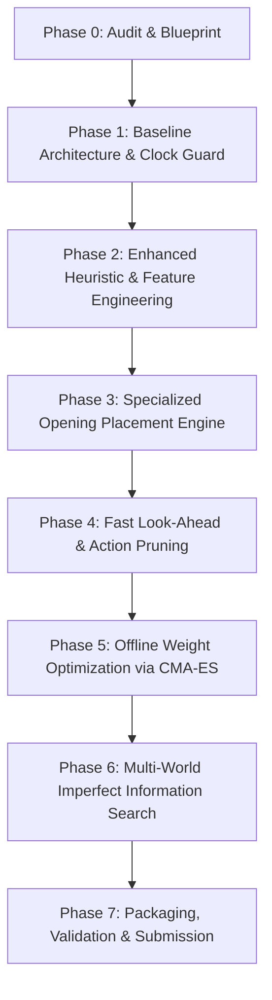

# Implementation Roadmap: Competition-Ready Catan AI

## 1. Architectural Strategy & Design Principles

To defeat both reference anchors (**F** and **O**) and rank among the top teams on robustness and strength, our agent architecture must capitalize on the key structural characteristics of the competition:

1. **Leverage the Compute Asymmetry**:
   - Bot F uses only **~158 ms per game** (~2.9 ms per decision).
   - Our allowance provides **~1,000 ms per game** (up to 1,500 ms ceiling), offering **~6x more compute** than F.
   - We must convert this compute into high-yield search and evaluation depth, rather than wasting it on redundant Python deep copies.

2. **Overcome F's Three Primary Vulnerabilities**:
   - **Opening Placement Blindness**: F treats initial settlements with standard 1-ply weights, ignoring long-term production diversity (5-resource balance), port synergy, and opponent blocking.
   - **Information Flatness**: F samples a single world ($N=1$), leaving it susceptible to dev card blindsiding.
   - **Horizon Myopia**: F cannot chain actions (e.g., Road + Settlement in the same turn, or Maritime Trade + Dev Card Buy).

3. **Strict Zero-Fault & Clock-Budget Discipline**:
   - Exceeding the clock degrades the agent to uniform random moves. We implement an **adaptive time manager** that checks `obs.cpu_left` before allocating depth or world-samples.
   - Clean modular architecture enabling independent testing and seamless fallbacks.

---

## 2. Proposed Target Architecture

The target system is decomposed into decoupled, single-responsibility modules:

```
my_team/
├── agent.py                     # Competition entry-point (Agent class)
├── core/
│   ├── time_manager.py          # Adaptive clock allocation & decision budgeting
│   ├── action_prioritizer.py    # Move ordering, action pruning, dominant move filtering
│   └── state_adapter.py         # Fast state cache & delta updates from Obs
├── evaluation/
│   ├── features.py              # High-speed feature extraction (Catan production, ports, roads)
│   ├── heuristic_eval.py        # Hand-tuned & optimized linear evaluation function
│   └── learned_value.py         # (Optional) Lightweight neural / linear model for value inference
├── search/
│   ├── search_controller.py     # Unified search orchestrator with time-abort guards
│   ├── opening_book.py          # Fast heuristic / exact evaluator for initial placements
│   ├── expectimax.py            # Selective depth-limited search over same-turn & chance nodes
│   └── world_sampler.py         # Multi-world ensemble aggregator (acting under imperfect info)
└── training/ (Offline only)
    ├── self_play.py             # Match batch runner & trajectory collector
    ├── optimize_weights.py      # CMA-ES / Cross-Entropy weight optimizer vs F
    └── smoke_test.py            # Local packaging, memory, and clock validator
```

### Module Responsibilities:
- **`time_manager.py`**:
  - Dynamically budgets time per decision:
    $$t_{\text{target}} = \frac{\text{obs.cpu\_left}}{\max(1, \text{estimated\_turns\_remaining})} \times \text{urgency\_multiplier}$$
  - Grants higher urgency to Opening Settlements (Turns 0–1) and Late-Game Victory Closes (when actual VPs $\ge 8$).
- **`action_prioritizer.py`**:
  - Prunes objectively dominated moves before simulation:
    - Filters redundant 4:1 maritime trades when 3:1/2:1 ports exist.
    - Prunes robber coordinates that do not target the leader or resource-producing tiles.
    - Sorts winning moves (10 VPs) and immediate settlement builds first.
- **`opening_book.py`**:
  - Initial settlement/road placement is the highest-leverage decision in Catan.
  - Evaluates:
    - 5-resource coverage (minimizing 0-production resources).
    - Dot distribution (optimal pip count: 6s and 8s).
    - Port proximity matching high-production tiles (e.g. Ore 2:1 port with high Ore output).
    - Opponent expansion denial.
- **`expectimax.py` & `search_controller.py`**:
  - Performs 2-ply same-turn search: tests compound plays (e.g., `MARITIME_TRADE` $\rightarrow$ `BUILD_SETTLEMENT`).
  - Supports iterative deepening so the agent can yield its current best move if `obs.cpu_left` approaches threshold.
- **`world_sampler.py`**:
  - Samples $K \in [2, 5]$ plausible worlds when the opponent holds unplayed dev cards and the decision is critical.
  - Averages utility across sampled worlds to make robust decisions under hidden information.

---

## 3. Implementation Phases & Dependencies



### Phase 1: Clean Baseline Harness & Adaptive Clock Manager
- **Goals**: Create standard `my_team/agent.py` matching F's performance while establishing guaranteed 0-error, adaptive time management.
- **Files Modified / Created**: `my_team/agent.py`, `my_team/core/time_manager.py`.
- **Testing**:
  - Run `catan_kit.selfcheck`.
  - Evaluate 50 games vs `examples/f_agent.py` to confirm parity ($\approx 50\%$ win rate, 0 timeouts, $< 200$ ms mean CPU).

### Phase 2: Enhanced Heuristic Value Function
- **Goals**: Upgrade the 13-feature heuristic with critical strategic dimensions missing in F:
  - 5-resource variety multiplier.
  - Port ownership bonuses paired with production yields.
  - Road connectivity & settlement spot reservation.
  - Robber placement impact (differential enemy resource choking).
  - Endgame victory-point distance.
- **Files Modified / Created**: `my_team/evaluation/features.py`, `my_team/evaluation/heuristic_eval.py`.
- **Testing**:
  - Evaluate 100 games vs `examples/f_agent.py`. Target win rate $\ge 60\%$.

### Phase 3: Opening Placement Engine
- **Goals**: Implement high-precision opening settlement and road evaluator.
- **Strategy**: Opening moves represent 2 decisions per game but determine ~60% of win probability. Spend up to 80–100 ms of the initial 300 ms allowance evaluating combinatorial placement pairs.
- **Files Modified / Created**: `my_team/search/opening_book.py`.
- **Testing**:
  - Evaluate 100 games vs `examples/f_agent.py`. Target win rate $\ge 68\%$.

### Phase 4: Action Pruning & Same-Turn Look-Ahead
- **Goals**:
  - Eliminate dominated maritime trades and redundant robber moves.
  - Search 2-step compound actions (e.g. Trade $\rightarrow$ Build Settlement; Road Building $\rightarrow$ Settlement).
- **Files Modified / Created**: `my_team/core/action_prioritizer.py`, `my_team/search/search_controller.py`.
- **Testing**:
  - Profile decisions per second and CPU overhead.
  - 200 games vs `examples/f_agent.py`. Target win rate $\ge 75\%$.

### Phase 5: Offline Parameter Optimization (CMA-ES)
- **Goals**: Automatically tune evaluation weights against F using derivative-free optimization (CMA-ES / Genetic Search).
- **Execution**: Run headless simulation batches across local CPU cores using `catan_kit.match.play_chunk`.
- **Files Modified / Created**: `my_team/training/optimize_weights.py`.
- **Testing**:
  - Compare optimized weights against F over 400 games. Target win rate $\ge 82\%$.

### Phase 6: Multi-World Uncertainty Ensemble
- **Goals**: Sample multiple worlds ($K=3$) when opponent holds unplayed dev cards and agent is in high-stakes decisions (e.g. guarding against opponent surprise VP wins).
- **Files Modified / Created**: `my_team/search/world_sampler.py`.
- **Testing**:
  - Ensure total CPU per game stays safely under 600 ms on local laptop ($\approx 1,000$ ms on reference machine).

### Phase 7: Submission Packaging & Verification
- **Goals**: Create automated zip bundler, run self-check, run test games under simulated sandbox limits, verify zip size $\le 100$ MB.
- **Files Modified / Created**: `my_team/package_submission.py`.

---

## 4. Preservation of Existing Infrastructure

The following repository components must remain strictly untouched and preserved:
1. `catan_kit/`: All harness, hosting, IPC, determinism patches, and observation modules must remain unchanged to ensure local evaluations exactly match the scoring server.
2. `examples/`: `f_agent.py` and `random_agent.py` remain as immutable benchmark references.
3. `requirements.txt`: No new heavyweight packages. All proposed logic runs cleanly on standard Python, NumPy, SciPy, and existing PyTorch.

---

## 5. Risk Assessment & Fallback Matrix

| Risk Scenario | Impact | Mitigation Strategy | Fallback Option |
|---|---|---|---|
| **CPU Clock Overrun on AWS Machine** | Disqualification / random moves played | Reference CPU is $\sim 1.5-2\times$ slower than modern laptop. Enforce local CPU budget $\le 500$ ms/game. | Time Manager automatically throttles search depth to 1-ply if `obs.cpu_left < 0.200` s. |
| **Out of Memory (2.0 GB Limit)** | Immediate process termination | Avoid caching thousands of `Game` instances. Use lightweight dataclasses or primitive feature arrays. | Garbage collection in `settle()` between games; disable rollout tree caching. |
| **Simulation Copy Overhead** | High CPU consumption | Pre-prune illegal or dominated actions *before* calling `world.copy()`. | Direct feature scoring on current state without deep copies for low-impact decisions. |
| **Optimization Overfitting to F** | Poor performance vs O & other teams | Test candidate weights against diverse baselines (F, Contender weights, mutant F). | Revert to robust hand-engineered heuristic weights with variety guarantees. |
| **Opponent Surprise VP Wins** | Sudden loss | Track opponent dev card purchase history and model VP probability in utility function. | Default to conservative defensive blocking if opponent has $>2$ unplayed dev cards and $\ge 8$ public VPs. |
